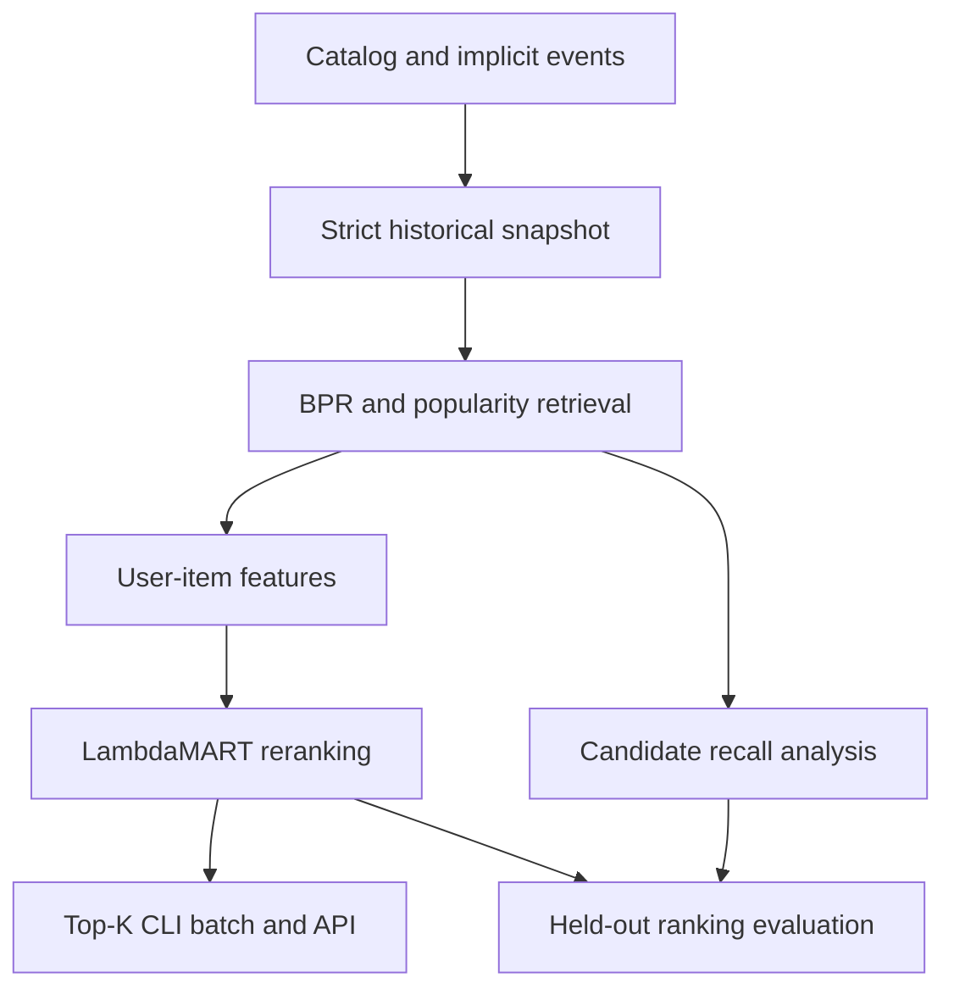

# RankForge

A personalized e-commerce recommendation prototype with **two stages**: weighted
implicit collaborative filtering retrieves a candidate pool; LightGBM LambdaMART
reranks it into Top-K results. Includes popularity baselines, temporal feature snapshots,
negative sampling, ranking evaluation, cold-start behavior, tuning and error analysis.

This is a focused ML/model project. No cloud infrastructure or frontend is required.
The ZIP includes code and synthetic CSV fixtures, not trained model artifacts or
measured recommendation quality. Training, tests, tuning and evaluation were not executed
before packaging. Follow the commands below locally, one step at a time.

## Overview and real-world problem

Given a user's prior views, clicks, carts and purchases, return useful eligible products.
Candidate retrieval and final ordering have separate failure modes: an item the candidate
stage misses cannot be recovered by reranking. Ranking must respect time and query groups,
and comparisons need baselines and held-out targets, not similarity scores alone.

## What the project demonstrates

- Implicit weighted BPR matrix factorization on a sparse interaction matrix.
- Candidate retrieval, negative sampling, temporal feature engineering and LambdaMART.
- Query/group construction, cold users/items, temporal hold-out ranking metrics.
- Baseline comparisons, tuning/ablation code, error reports and native feature importance.
- Reproducible metadata, safe factor serialization, batch output and FastAPI inference.

Implemented: all paths above. Configurable: event weights, retrieval mix/count, BPR and
ranker parameters, negatives, exclusions, features, K values and cold-user fallback.
Future: real exposure data, rolling request origins, propensity-aware evaluation,
time-varying inventory, approximate nearest-neighbor retrieval and live event updates.

## Architecture



## Repository structure

- `src/rankforge/`: generator, validation/snapshots, BPR, candidates, features,
  ranker queries/training, metrics, evaluation, artifacts, inference, experiments, API/CLI.
- `configs/demo.yaml`: default local model configuration.
- `configs/search.yaml`: Optuna search space; `configs/ablations/`: comparison configs.
- `data/sample/`: users, catalog, implicit events and synthetic provenance.
- `tests/`: deterministic data, leakage, sparse factors, retrieval/negative sampling,
  query groups, features, metrics, tiny lifecycle and API contracts.
- `docs/`: temporal/evaluation contract and licensing.
- `.github/workflows/ci.yaml`: CPU test/lint workflow.

## Prerequisites, Debian setup and installation

Python 3.11, uv, Git and VS Code. Install OpenMP runtime for LightGBM on Debian.
No Docker, Java, Spark or Kafka is required.

```bash
sudo apt update
sudo apt install -y curl unzip git libgomp1
```

If uv is already installed, skip installation:

```bash
curl -LsSf https://astral.sh/uv/install.sh | sh
export PATH="$HOME/.local/bin:$PATH"
uv python install 3.11
```

Extract and open:

```bash
mkdir -p ~/projects/ml
unzip ~/Downloads/RankForge.zip -d ~/projects/ml
cd ~/projects/ml/RankForge
uv sync --frozen --python 3.11
code .
```

VS Code: install the Microsoft Python extension and select `.venv/bin/python` with
**Python: Select Interpreter**. Run every command from the repository root in its terminal.
Dependency installation needs network; model/data operations use only local files.

## First essential checks: stop after each output

```bash
uv run pytest -q
uv run rankforge audit --config configs/demo.yaml
uv run rankforge train --config configs/demo.yaml
uv run rankforge recommend --artifacts artifacts/demo --user user-0000 --k 10
```

Tests use deterministic small fixtures; one tiny BPR/LambdaMART lifecycle is included.
Audit should return `passed: true`; training writes `artifacts/demo/checksums.json`;
recommend returns unique eligible IDs, ranks, model version and strategy. This verifies
prototype mechanics, not useful quality. Do not run every experiment just to verify setup.
An existing completed artifact directory is protected; use a new `output_dir` in a copied
config for a new run. For example `cp configs/demo.yaml configs/local.yaml`, then change
`output_dir` before retraining. No automatic overwrite or deployment/promotion exists.

## Synthetic data and generation

Bundled default: 60 users, 100 items, 4,000 events over 50 days from 2026-01-01 UTC.
Latent category affinity, price sensitivity and activity generate noisy behavior with
popularity bias, freshness, repetition and sparse events. Last 15% of users arrive on
day 35; last 10% of items arrive on day 32. This produces factor-cold users/items later.
Generated preference and sensitivity columns are generator documentation only: data
loading exposes just user IDs/creation times to the pipeline. Affinity is learned from
past observed events. No known secret preference is served as a feature.

```bash
uv run rankforge generate --output data/generated --users 100 --items 200 \
  --events 10000 --seed 42 --popularity-bias 1.0
```

Copy demo config, change `data_dir: data/generated` and `output_dir` to a fresh path.
Increasing `--popularity-bias` creates a more concentrated item distribution; default
0 removes intrinsic popularity weighting (other affinity signals remain). Generated
interactions are outcomes, not logged randomized exposures, and do not prove real-world
recommendation utility. See `data/sample/dataset.json` for provenance. No public data
download is required. A public-data adapter is deliberately omitted.

Input CSV schema:

| Table | Required fields |
|---|---|
| users.csv | user_id, created_at |
| items.csv | item_id, category, brand, price, created_at, available |
| interactions.csv | interaction_id, user_id, item_id, timestamp, event_type |

UTC offsets are required. IDs are strings, IDs unique per entity/event; item prices
positive, events reference valid entities and cannot predate creation. `available` is
constant for this prototype, not a historical inventory table. Audit checks those
contracts and nonempty temporal windows. Repeated user-item events are valid behavior.

## Implicit feedback and temporal splitting

Event weights (default view=1, click=2, cart=4, purchase=8) sum into the BPR sparse matrix
and historical popularity/affinity features. They are positive confidence signals, not
explicit star ratings. Missing interactions are unlabeled, not certain dislikes.
Future supervised relevance grades are view=1, click=2, cart=3, purchase=4; weights and
grades have different roles. Ranker gains are `[0,1,3,7,15]`.

| Period | Boundary | Role |
|---|---|---|
| Candidate history | timestamp < Jan 21 | Fit BPR; freeze category/brand vocabularies |
| Ranker outcome labels | Jan 21–Jan 31 | Features/candidates at Jan 21, fit LambdaMART |
| Validation labels | Jan 31–Feb 10 | Features at Jan 31; early stopping/tuning |
| Test labels | Feb 10–Feb 20 | Features at Feb 10; final held-out evaluation |

Windows use left-inclusive/right-exclusive UTC bounds. No future event appears in
snapshot counts/popularity/affinity. The candidate model is frozen after Jan 21; history
updates at validation/test origins are allowed because those events are now in the past.
Ranker never fits validation/test labels. Persisted serving history stops strictly before
Feb 10; the API serves that fixed snapshot. Temporal splitting is more realistic than
random event splitting but one request origin per period remains a limitation.

## Candidate generation and matrix factorization

`WeightedBPR` implements a pairwise logistic ranking objective with L2 regularization.
SciPy CSR aggregates positive event weights. Users sample uniformly; an observed positive
samples proportionally to its aggregate weight; an unobserved prefix item samples uniformly.
NumPy user/item latent factors score dot products. This is BPR with weighted positive
sampling, not ALS confidence weighting. Implementation is readable and appropriate to
small local experiments, not a large-scale optimized retrieval engine.

Default 50 candidates: primary BPR, 20% historical popularity, 10% newest eligible items,
deduplicated with primary-fill. Popularity can be category-aware using historical user
affinity. Purchased items are excluded; all-seen exclusion is optional. Constant unavailable
items and items not yet created are removed. Retrieval includes a controlled new-item
freshness reserve so a missing factor does not make an item permanently unreachable.
Small catalogs may return fewer than the requested number.

## Baselines and training stages

One training command fits candidates, constructs ranking queries and fits the ranker.
It writes `candidate_training.json`, `ranking_train.csv`, `ranking_groups.json`, best
LightGBM booster, factor NPZ, encoders, feature columns, config/version and checksums.
No disconnected manual stage files need to be reconstructed.

```bash
uv run rankforge train --config configs/demo.yaml
uv run rankforge recommend --user user-0000 --method popularity --k 10
uv run rankforge recommend --user user-0000 --method category --k 10
uv run rankforge recommend --user user-0000 --method cf --k 10
uv run rankforge recommend --user user-0000 --method ranker --k 10
```

Popularity/category baselines score the full eligible catalog. CF baseline ranks the
blended retrieved pool by BPR score. The final ranker scores that same pool for warm
users. Baseline/candidate comparisons share catalog, exclusion and prediction time.
No model is claimed to win until you evaluate it.

## Negative sampling and query groups

Ranker query = one user at one historical recommendation origin. All that user's
candidate rows are contiguous, with an explicit group-size vector summing to total rows.
Training injects eligible observed future positives and samples items with no event in
that label window as weak negatives. It does not imply explicit dislike. This sampling
creates supervised signal but differs from the real retrieval distribution.

- `random`: uniform unobserved future items.
- `popularity`: historical popularity-weighted sampling.
- `hard`: high-retrieval candidates with no future event, filled by random candidates.

Validation/test never inject positive items: they score only actual retrieved candidates.
Ranker fit/early stopping skip groups without relevance variation. Full evaluation includes
all eligible queries with at least one positive target. Exposure bias remains unresolved.

## Feature engineering and learning-to-rank

Basic features: log popularity, price, age, category/brand codes, past category affinity.
Rich features: historical user events/purchases/recency/mean purchase price; smoothed
item purchase-per-event rate; user-item events/recency; relative price difference;
category-weighted popularity; missing item-factor indicator. CF score is optional.
The item purchase rate is a descriptive event ratio, not a calibrated conversion rate.
Category/brand mappings freeze at candidate cutoff; later unseen categories map to -1.

LightGBM `LGBMRanker(objective="lambdarank")` optimizes within query groups, with
integer relevance labels and configurable gains. Early stopping uses a future validation
period, not test. Scores are ordering scores and can be negative; they are not probabilities.
Native gain importance is saved in `feature_importance.json`; do not interpret it causally.

## Ranking metrics, diversity and coverage

Evaluate on validation while developing; test only after selecting settings:

```bash
uv run rankforge evaluate --artifacts artifacts/demo \
  --split validation --output outputs/validation
uv run rankforge evaluate --artifacts artifacts/demo \
  --split test --output outputs/test
```

Metrics: Precision@K, Recall@K, graded NDCG@K, MAP@K, hit rate and truncated MRR@K,
for K=5/10/20 by default. Positive target=eligible future click/cart/purchase (grade>=2).
NDCG additionally gives weak views grade-1 gain. Precision divides by requested K;
MAP divides by min(eligible positive count,K). Users without eligible positives are
skipped and reported. Existing excluded purchases/future-unavailable items are removed
from truth and counted explicitly. These are novel eligible recommendation metrics,
not a measure of all future purchase retrieval.

Reports compare four methods and include warm/cold and active/less-active slices,
configured candidate recall, catalog coverage, category diversity/concentration, mean
smoothed novelty and popular-item fraction. Item-slice micro recall and miss counts include category,
factor-cold item and popular/long-tail flags. No diversity reranking is performed. Results reflect
synthetic outcome/exposure bias; they are not causal online improvements.

## Error analysis

- `metrics.json`: metrics/definitions/slices/coverage and target exclusion counts.
- `per_query.csv`: every user/method/K metric.
- `poor_users.csv`: low-recall ranker queries near K=10.
- `errors.csv`: eligible targets missed by retrieval vs present but ranked below cutoff;
  cold-start fallback misses are marked separately; category/cold-item/long-tail flags.

Candidate recall bounds the warm-user ranker path, but cold serving intentionally bypasses
that pool and uses popularity fallback. Separate these failures when deciding whether
to improve factor retrieval, candidate mix, ranking features or cold-start strategy.

## Hyperparameter tuning and ablations

Optional Optuna tunes BPR dimension/epochs, candidate size, ranker rate/leaves/regularization,
negative strategies and feature choices. Objective: validation ranker NDCG at configured K
nearest 10. All data windows remain fixed; no trial scores the held-out test.

```bash
uv sync --frozen --extra tuning
uv run --extra tuning rankforge tune --config configs/demo.yaml \
  --space configs/search.yaml --trials 8 --output outputs/tuning
```

Use a new study/output directory each time. This runs real model fitting per trial;
do not run it just to confirm the pipeline. Each trial preserves artifacts/config/validation
reports; `best.json` identifies validation-selected settings. After selection, evaluate
only the chosen artifact on test.

Ablation configs: CF score on/off, basic/rich features, random/hard negatives,
popularity/collaborative retrieval, global/category cold fallback, uniform/event weights,
candidate size 30/50. K sensitivity is already present in the metric report.

```bash
uv run rankforge compare --configs \
  configs/ablations/no_cf_score.yaml configs/ablations/basic.yaml \
  configs/ablations/random_negatives.yaml configs/ablations/popularity_candidates.yaml \
  --output outputs/ablations
```

For a clean reference comparison include a copied demo config with a fresh output path.
Match seed, windows and all other settings when isolating a change. Popularity retrieval
still keeps configured freshness/popularity reserves; set fractions to zero for a pure
retrieval experiment. Edit search space/configs for event weights or retrieval quotas.
No ablation outcomes are bundled.

## Cold-start handling and inference

New/unknown-factor users use category-aware popularity if past history exists, otherwise
global popularity. They bypass the trained ranker. Unknown brand-new IDs are allowed.
New catalog items have no factor; freshness reserves admit them for warm-user reranking
using content/price/age. No inventory record means the item is not recommendable.

```bash
uv run rankforge recommend --artifacts artifacts/demo --user new-user --k 10
uv run rankforge recommend --artifacts artifacts/demo --user user-0000 --k 5 \
  --category electronics
```

Category filtering restricts returned items; for warm users it filters the configured
pool and may return fewer items than requested. No fabricated generated preference is
injected for new users. A new data/catalog model requires retraining/exporting a new snapshot.

## Batch recommendation

```bash
uv run rankforge batch --artifacts artifacts/demo --users data/sample/users.csv \
  --k 10 --output outputs/recommendations.csv
```

Output: user ID, rank, item ID/category, score, CF candidate score, model version,
strategy and fixed `as_of`. Optional Parquet:

```bash
uv sync --frozen --extra parquet
uv run --extra parquet rankforge batch --artifacts artifacts/demo \
  --users data/sample/users.csv --output outputs/recommendations.parquet
```

## FastAPI serving

After training, in terminal one:

```bash
RANKFORGE_ARTIFACTS=artifacts/demo \
  uv run uvicorn rankforge.api:app --host 127.0.0.1 --port 8000
```

Terminal two:

```bash
curl -sS http://127.0.0.1:8000/health
curl -sS http://127.0.0.1:8000/ready
curl -sS 'http://127.0.0.1:8000/recommend/user-0000?k=10'
curl -sS 'http://127.0.0.1:8000/recommend/new-user?k=5'
```

Swagger: http://127.0.0.1:8000/docs. Stop with Ctrl+C. If another project's API uses
8000, stop it or use `--port 8001` and adjust curl URLs. Readiness is 503 without configured
artifacts. K beyond the model candidate-count limit returns 422. Load verifies checksums.
API has no authentication, live interactions, production rate limiting or distributed state.

## Tests and CI

```bash
uv run ruff check src tests
uv run pytest -q
```

Offline-safe tests require no datasets/services after dependencies are installed. They
cover deterministic generation, timezone/window correctness, future feature isolation,
weight mapping, CSR aggregation, BPR serialization, exclusions, negatives, group sums,
feature schema, metric arithmetic, cold fallback and artifact/API contracts. A tiny
synthetic lifecycle test trains one BPR epoch and eight trees and evaluates fixture paths;
it is not a quality benchmark. CI runs this small CPU suite, not tuning/large experiments.

## Known limitations and future improvements

Synthetic data is not a real recommendation relevance benchmark. No logged exposures,
propensities, randomized intervention or actual conversion attribution exist. Aggregate
label horizons conflate repeat behavior and intent; BPR/feature snapshots become stale.
Static item availability is not inventory replay. One training query per user, injected
training positives and informative-group early stopping are simplifying assumptions.
Python BPR and dense catalog scoring do not demonstrate large-scale throughput.
Checksum integrity detects accidental changes, not malicious untrusted artifact files.
No experiment metrics, business lift, production readiness or speed claims are supplied.

Next improvements should follow measured validation errors: licensed real exposures,
rolling historical requests, smarter negative definitions and unseen-item retrieval,
not extra infrastructure. See docs/experiment_contract.md for precise boundaries.

## License

MIT for original code and generated sample data. Dependencies retain their upstream
terms; no public datasets or pretrained assets are redistributed. See docs/licensing.md.
